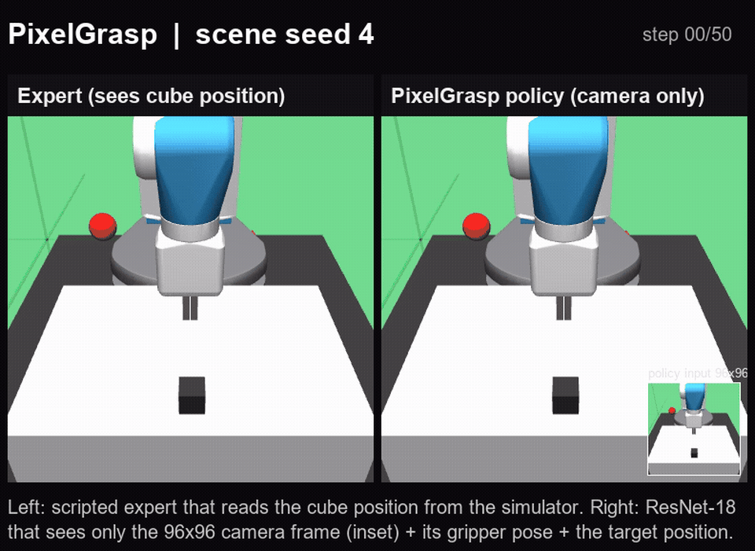

# PixelGrasp

A robot arm learns pick-and-place **from a single camera**, in simulation, by copying a scripted expert.
**299 / 300** held-out scenes solved (95% CI 98.1–99.9%). Trained in 45 minutes on a laptop GPU.



*Left: the scripted expert, which reads the cube position from the simulator. Right: the learned policy, which sees only
the 96×96 camera frame (inset), its own gripper pose, and the target position. Same scene, same 50-step budget. Green = success.*

| | Success on 300 frozen eval seeds |
|---|---|
| Scripted expert (privileged state) | 300 / 300 |
| **PixelGrasp**, action chunk k=8 | **299 / 300** (99.7%) |
| PixelGrasp, second training seed | 297 / 300 (99.0%) |
| PixelGrasp, single-step k=1 | 297 / 300 (99.0%) |
| Do nothing / random | 11 / 300 (3.7%) |

Full tables, ablations, camera-shift robustness and the failed runs: **[RESULTS.md](RESULTS.md)**.
Every number has a command: **[VERIFY.md](VERIFY.md)**. 71-second video: `results/showcase_1116.mp4`.

## What it is

- **Task:** `FetchPickAndPlace-v4` (Gymnasium-Robotics, MuJoCo 4). Cube and target are randomised every episode; the
  target is in the air half the time. 50-step horizon, success = cube within 5 cm of the target at the end.
- **Policy input:** one RGB frame (96×96, fixed third-person camera) + gripper xyz + two finger widths + target xyz.
  **The cube position is never given.** The network has to find the cube in the image.
- **Policy:** ResNet-18 (ImageNet init) → MLP → the next *k* actions (dx, dy, dz, gripper). k=8 predicted, 4 executed,
  then re-plan ("action chunking", as in ACT). Gripper is a separate open/close head. 11.4 M parameters, 3 ms per decision.
- **Training:** behaviour cloning. A scripted phase-machine expert (hover → descend → close → carry → hold) does the task
  5,000 times with privileged state; every frame is saved. The policy is trained on 2,000 of those episodes (100,000 frames)
  with L1 on positions, BCE on the gripper, AdamW, one-cycle LR, bf16, random-shift augmentation. 12 epochs ≈ 45 min on an
  RTX 4060 Laptop.
- **Evaluation:** the policy drives the robot closed-loop on 300 seeds it has never seen. Each failure is classified:
  *never reached / never grasped / dropped / misplaced*. Checkpoints are selected on a separate 100-seed dev set.

## What went wrong before it worked

Three configurations failed during development; their failure modes drove the final design:

1. **30%** (best checkpoint, epoch 5; 20% at the end of training) – goal read from pixels. The target is a ~17-pixel red dot; its *height* is ambiguous from one fixed camera, so
   the policy lifted the cube and carried it to an average location.
2. **1%** – same data, k=8 action chunking. Averaging over 8 future steps amplified the height ambiguity instead of smoothing it out.
3. **19%** – target given as a vector, but the demos stopped at the moment of success. In a scratch diagnostic on 60 episodes the policy came within 5 cm of the target in 98% and then drifted off in 88% (that checkpoint was deleted when the data was re-collected; the number is not reproducible from this repo): "hold still at the goal" was never in the data.

Fix: give the target as the task command (what a human would say: "put it there"), and record the full horizon so the
hold phase is demonstrated. With both, 98–100% on dev seeds; the no-target ablation then reaches 82.7% on the eval seeds.

## Limits (honest)

- Simulation only. No real robot, no ROS, no Isaac Sim.
- The demonstrator is a script, not a human; the task is a single cube on an empty table under fixed lighting.
- Moving the camera 3° / 6° / 10° after training drops success to 91% / 73% / 55%. Measured, not fixed.
- One camera, no depth. The target comes in as a vector *because* its 3D position cannot be read from one view.

## Run it

```bash
# see INSTALL.md for torch; then
pip install -r requirements.txt && python -m pytest tests -q
python -m pixelgrasp.eval --policy expert --seeds 300 --out results/baseline_expert.json
python -m pixelgrasp.collect --episodes 5000 --out data/demos --workers 10
python -m pixelgrasp.train --data data/demos --out runs/goal_k8 --chunk 8 --exec-steps 4 --epochs 12 --max-train-eps 2000 --augment --goal
python -m pixelgrasp.eval --policy bc --ckpt runs/goal_k8/best.pt --seeds 300 --out results/goal_k8.json --video results/goal_k8.mp4
```

Layout: `pixelgrasp/env.py` (camera, expert, failure taxonomy, seed ranges) · `collect.py` · `check_data.py` (open-loop
replay + frozen-observation checks) · `policy.py` · `train.py` · `eval.py` · `video.py` · `tests/` (14) ·
`scripts/make_results.py` (RESULTS.md is generated from `results/*.json`) · `RESEARCH.md` (what others got on this task).

Trained checkpoints (`runs/goal_k8/best.pt`, 45 MB) and the 7 GB demo set are not in git; the commands above regenerate them.

## Why this exists

A two-week sprint to earn one honest line on a resume for a Physical-AI internship: computer vision + deep learning +
robotics simulation, with numbers a reviewer can re-run. Built by Yashash Mathur, Nov 2026. MIT licence.
